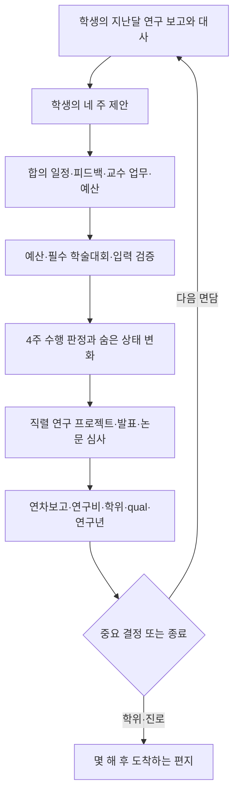
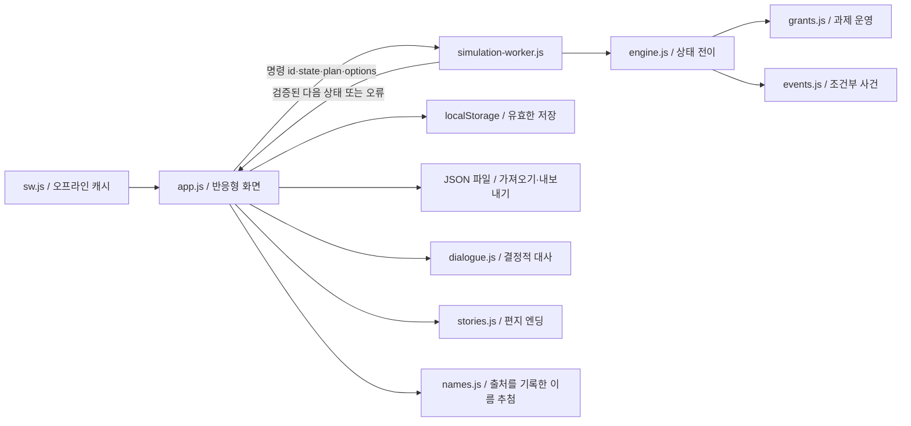

# Professor Maker 아키텍처 · 한국어 경영·육성 시뮬레이션

## 제품과 시간

플레이어는 조용하고 무난한 STEM 교수로 시작한다. 한 학생의 커리어와 연구실을 함께 경영하며, 반복적인 압박 선택으로 호랑이 교수의 지도 이력도 만들 수 있다. 학생은 성격 유형 하나에 고정되지 않는다. 초기 기질 위에 지도·일정·성과·관계의 경험이 축적된다.

96개월 × 4주 = 384개의 활동을 월간 면담 96회로 압축한다. 한국 학년은 3월–다음 해 2월이다. 약 15분은 설계 목표이며 독자 플레이로 검증된 수치는 아니다. 선택이 필요한 시점에 멈추고, 실시간 대기 타이머는 없다. UI는 한국어에 집중한다. 보존된 영어 엔진은 9월 시작이며 후속 공개 대상이다.

## 실행 구조

정적 배포와 브라우저 내 시뮬레이션으로 첫 버전을 구현했다. 별도의 서버 데이터베이스가 없는 단일 플레이 게임이다. 시뮬레이션 계층을 Worker로 분리했으며 같은 엔진을 Node에서 테스트한다. 클라우드 세이브나 공유 랭킹을 추가할 때 서버는 동일한 명령·스키마를 사용할 수 있지만, 현재 기기 저장이 서버의 권위나 부정행위 방지를 제공한다고 주장하지 않는다.

| 파일 | 책임 |
|---|---|
| `dist/engine.js` | 생성, 주별 수행, 프로젝트, 학위·결정 큐, 진로, 스키마 검증 |
| `dist/grants.js` | 3년 과제, 연차보고, 후속 심사, 지연·공백지원 |
| `dist/simulation-worker.js` | 요청별 독립 계산, 구조화된 오류 응답 |
| `dist/app.js` | 화면, 입력·저장·편지함, Worker 요청 관리 |
| `dist/dialogue.js` | 31범주·258개 대사; 시드와 이력에 따라 선택, 상태 불변 |
| `dist/events.js` | 32개 사건, 선행 실적·단계·재발 간격·일회성 제한 |
| `dist/stories.js` | 14개의 진로·중간 종료 후일담 |
| `dist/names.js` | 이름·성씨 빈도 추첨과 출처·범위 기록 |
| `tests/*.test.mjs` | 상태 불변·도달 가능한 엔딩·입력·콘텐츠 계약 검증 |

`simulateMonth(state, fourWeekPlan, options)`와 `decide(state, choice)`는 입력을 변경하지 않고 다음 상태를 반환한다. 저장된 32비트 시드로 재현 가능한 난수를 사용한다. 화면을 다시 그리거나 대사를 읽는 행위는 난수를 소비하지 않는다. 동시에 여러 달을 진행하지 못하도록 요청 중 조작을 막고 요청 ID와 타임아웃을 둔다. Worker 생성이 불가능하면 같은 엔진을 메인 스레드에서 실행한다.

스키마 VERSION 3은 범위·연속 카운트·논문과 투고 관계·프로젝트·주간 결과·사건 조건·과제 기록을 확인한다. 가져오기 크기는 1.5MB, 편지함은 40개로 제한한다. 이름·가져온 기록은 HTML 이스케이프한다. 수정 중 유효하지 않은 업무 배분을 자동 저장하지 않아 마지막 정상 저장이 유지된다. 오프라인 캐시는 상대 경로를 사용하므로 GitHub Pages의 저장소 하위 경로에서도 동작한다.

## 숨은 파라미터

UI는 아래 수치나 체력·의욕·관계 게이지를 보여주지 않는다. 학생의 대사, 요청, 실험 결과와 논문 초고가 관찰 신호다. 공개 정보는 학위요건·남은 학기·성과·프로젝트 진도이며 교수의 네 업무 상태와 예산은 경영 지표다.

| 원값 범위 | 파라미터 | 주요 작용 |
|---|---|---|
| 0–999 | 예의범절 | 보고·대화 방식, 교육과 협업 경험 |
| 0–999 | 체력 | 주별 일정 수행, 휴식과 과로 |
| 0–999 | 정신력 | 스트레스 증가의 완충, 실패 후 반응 |
| 0–999 | 언어 | 논문 초고 진행, 발표와 수상 판정 |
| 0–999 | 학습·연구 수행 | 문헌·실험·분석의 효율과 학위 준비 |
| 0–100 | 스트레스 | 지속적으로 높을 때 경고·휴학 |
| −100–100 | 사교성 | 협업·대외 활동 효율과 대화 경향 |
| −100–100 | 창의성 | 연구 질문과 결과의 생산성 |
| −100–100 | 성실성 | 수행률 상승과 피로 비용 상승의 교환 |
| −100–100 | 라포 | 친밀감, 안부와 대화의 축적 |
| −100–100 | 신뢰 | 평가의 일관성·일정 합의·지원에 대한 믿음 |
| −100–100 | 운 | 제한된 확률 보정; 능력이나 노력의 대체가 아님 |

의욕, 자율성, 교육·산업·창업·홍보 경험, 직관과 자신감은 추가 숨은 진행 변수다. 비교와 확률은 `abilityScore`로 원값을 0–100에 정규화한다. 사건 효과도 같은 기준으로 작성한 뒤 원값 범위로 환산한다. 성별은 능력 보정을 하지 않는다. 생성 55:45는 요청에 맞춘 게임 가정이며 실제 전체 STEM 통계가 아니다.

수행확률은 체력·의욕·라포·신뢰·성실성·운·스트레스의 조합을 0.18–0.98로 제한한다. 성실성이 높으면 수행 가능성이 높지만 수행 시 체력 비용도 커진다. 낮은 성실성은 일정 완수가 적어질 수 있으나 피로를 덜 쌓는다. 정신력은 양의 스트레스 효과를 완충한다. 학생의 제안과 수정 계획을 비교하고, 경청·논의·강압의 맥락에 따라 신뢰를 조정한다.

연구 피드백은 이전 보고를 평가한다. 성과에 맞는 칭찬과 실패의 병목에 맞는 지적은 도움을 주며, 근거가 맞지 않으면 자신감·의욕·관계에 비용을 낸다. 강압은 당장의 실행률을 올릴 수 있지만 신뢰·라포·스트레스에 장기 비용이 생긴다.

## 커리어와 연구

학부연구생은 1–2년차다. 24개월에 석사 후 박사 또는 석박사통합을 결정한다. 석사는 48개월에 제출 논문 1개·발표 1개를 확인하며 부족하면 한 번, 6개월 보완할 수 있다. 통합 과정은 48개월, 순차 과정은 60개월에 qual을 치른다. 준비 연기는 두 번, 시험 실패 후 재응시는 한 번 허용한다. 48개월의 연구년과 qual이 겹치면 결정 큐로 순서대로 처리한다.

연구 질문 → 예비 실험 → 결과 검증 → 분석·그림 → 초고 → 심사의 6단계를 프로젝트별로 직렬 수행한다. 준비된 프로젝트의 발표는 한 번만 성과로 인정한다. 투고와 게재는 별도다. 심사는 월별로 진행하고 새 투고를 같은 달에 게재하지 않는다. 96개월 박사 심사는 qual 통과·제출 3개·게재 3개·발표 3개와 연구 준비를 요구한다. 모든 요건은 게임의 가상 학위 규칙이다.

4월과 10월 셋째 주는 고정 학술대회다. 이전 두 주 준비와 마지막 주 회복을 자유롭게 조절한다. 청강과 발표 실적을 구분한다. 여름·겨울방학 해외학회는 학생 단독·교수 동행을 선택한다. 지정된 성별이 같고 학생 숙박 동의가 있을 때만 공동 숙박 옵션을 제공하며, 다르거나 미지정이면 두 방을 사용한다.

한국어 남학생의 전문연 이벤트는 지정 대학원·선발 일정·복무 계획을 확인하는 상담 서사다. 자동 선발, 법적 신분이나 병역 해결을 보장하지 않는다. 규정 안내는 [병무청 공식 안내](https://www.mma.go.kr/contents.do?mc=mma0000765)로 연결한다.

## 연구실 경영

교수에게 매달 업무칸 8개를 학술·교육·행정·학생관리로 배분한다. 매달 운영·수업·연구년의 비용을 적용하고 한 영역이라도 0이면 게임오버다. 학생 이탈은 먼저 경고를 준다. 건강·스트레스의 지속적 고갈은 휴학, 관계·의욕의 지속적 붕괴는 중도 이탈로 구분한다.

인건비 계상률은 학년 첫 달에 10% 단위로 협의하고 학년 중 잠근다. 높을수록 의욕·직관·라포·신뢰가 좋아질 기회를 만들지만 연구비 지출이 늘어난다. 연구환경, 연구 지원과 대외홍보는 매달 조절한다. 지출은 신규 지원금 도착 전에 현재 잔액으로 감당해야 한다.

한국 표시 1예산단위는 10만원이다. 초기 게임 연구비는 600단위, 비용은 학생 단계 기준액 × 인건비율 + 환경 × 2 + 연구지원 × 2 + 홍보다. 방학 출장은 18/34/26단위의 추가 비용이다. 이 금액은 가격 조사나 실제 정산 기준이 아니다.

가상 과제는 3년 주기로 수행한다. 겨울의 행정 업무 또는 명시적 보고 활동이 연차보고를 남긴다. 보고 지연은 다음 입금 축소, 후속 과제 미선정은 한시적 교내 공백지원으로 이어진다. 후속 신청 준비·교수 연구·행정·제출 성과와 제한된 난수를 반영한다. 한국연구재단·산학협력단의 현실적인 역할을 참고하되, 실제 사업 심사를 시뮬레이션했다고 주장하지 않는다.

100% 인건비 기준 130만/220만/300만원은 [GNU 학생인건비 통합관리 안내](https://www.gnu.ac.kr/research/cm/cntnts/cntntsView.do?cntntsId=3988&mi=7451)의 **2023.03.01 기준**이다. 2026년 전국 공통 단가가 아니다. 실제 안내의 별도 통합계정과 BK21·장학금 등을 이유로 계상률을 낮출 수 없다는 구분을 존중한다.

기초연구의 지원 기간과 체계는 [NRF 2026년 기본연구 설명](https://webzine.nrf.re.kr/magazine/2604/sub1.php)을 참고했다. 원문은 1–5년 지원과 기본연구 A/B 등 실제 유형을 설명하지만 게임의 3년 주기와 입금·선정식은 독자 설정이다. 모든 재원을 교육부 지원으로 묶지 않는다. [연구실의 공개 논문](https://link.springer.com/article/10.1140/epjds/s13688-025-00566-6)에 명시된 NRF와 교육부·경상남도 RISE 협력의 구분도 배경에 참고했다.

연구 주제는 [Network Science Lab 공개 목록](https://sites.google.com/view/netscilab/publications)의 작은세계·커뮤니티·확산·생태계·전력망·교육과 지식생산을 참고해 새 질문으로 구성했다. 실존 과제번호·실적·연구자의 이름을 게임 속 가상 성과로 복사하지 않는다.

## 엔딩과 후일담

교수 TRUE 엔딩은 연구·학습·언어·사교·자율·교육·라포·신뢰·정신력·예의·의욕, 논문 7개·발표 6개·추천서 4개와 네 교수 업무를 모두 요구한다. 구체적인 숨은 기준은 플레이 화면에 공개하지 않는다. 이 조건은 채용 예측 모델이 아니다.

일반 진로는 정출연, 전공 사기업, 비전공 사기업, 창업, 미취업, 유튜버다. 산업·창업·홍보 경험에 따라 자격과 점수를 비교한다. 박사 요건을 충족하고 라포·신뢰가 높으며 정신력이 낮은 경우에는 교내연구원 히든 진로가 가능하다. 학생의 다른 삶을 실패로 단정하지 않는다.

편지는 학위 후 몇 개월 또는 몇 해가 지난 시점에 도착한다. 교수 엔딩은 박사후연구와 지원 과정을 지나 6년 뒤 학회에서 재회한다. 이는 아래 교수 표본의 중앙 연도차를 서사의 시간 참고로 쓴 것이며 취업확률이나 보장된 소요기간이 아니다. 사용자가 제공한 추천서·감사의 슬라이드·커피 이야기를 원작 편지로 반영했다.

## 통계의 적용 범위

| 근거 | 확인한 통계 | 사용 범위와 한계 |
|---|---|---|
| [사용자 교수 데이터](https://github.com/Gahyoun/professor-research-career-dashboard) | 현직 3,937명, 유효 학위–첫 임용 연도쌍 3,544개, 중앙 6년·사분위 3/9년 | 후일담의 시간. 현직 교수 생존자 표본으로 전체 박사의 임용률을 추정하지 않음 |
| [NCSES SED 2024](https://ncses.nsf.gov/pubs/nsf26315/report/notes) | 미국 내 확정 취업·포닥 33,765명 중 포닥 39% | 학위 직후와 임용 사이의 단계 구분. 전체 박사 또는 한국 통계와 혼합하지 않음 |
| [NCSES 진로](https://ncses.nsf.gov/pubs/nsf26315/report/postgraduation-trends) | 비포닥 미국 내 확정 취업 20,469명 중 기업 약 40%, 학계 약 40% | 다양한 진로. 학계 전체를 교수로 보거나 미확정 계획을 실업으로 간주하지 않음 |
| [Wapman 외, Nature 2022](https://www.nature.com/articles/s41586-022-05222-x) | 미국 내 박사학위 취득 교수 80%가 20.4% 대학 출신 | 구조적 임용 집중. 개인의 학교·성별을 고정 능력 보너스로 만들지 않음 |

`career-evidence.json`에는 제공된 공개 데이터의 집계만 보관한다. 현직 교수의 개인 레코드·사적 자료는 게임에 복사하지 않았다. 이름은 별도 [출처 문서](REFERENCE_SYSTEMS.md)의 1995년 확인 풀과 2015년 성씨 자료로 제한한다.

## 검증과 배포

엔진 28개와 콘텐츠 3개 테스트는 순수성·동일 시드 재현성·모든 범위·입력 거부·수행/피로 교환·예산/동의·학위 큐·과제 갱신을 검증한다. 양 달력의 전체 96개월 시드 플레이와 일반 6종·TRUE·교내연구원 실제 경로를 확인한다. 브라우저 검증은 월 진행·4월 3주 고정·잘못된 배분 저장 보호·대화상자·320/390/768/1360px을 확인한다. 추가로 오프라인 Worker와 학위결정 뒤 진행 재개를 확인한다.

GitHub Actions는 테스트 후 정적 파일을 Pages로 배포한다. 웹과 모바일은 동일한 엔진·저장 스키마를 사용한다. 서비스 워커 캐시 버전은 코드 변경과 함께 갱신한다. 기기 사이의 자동 동기화나 로그인은 현재 제공하지 않는다.
